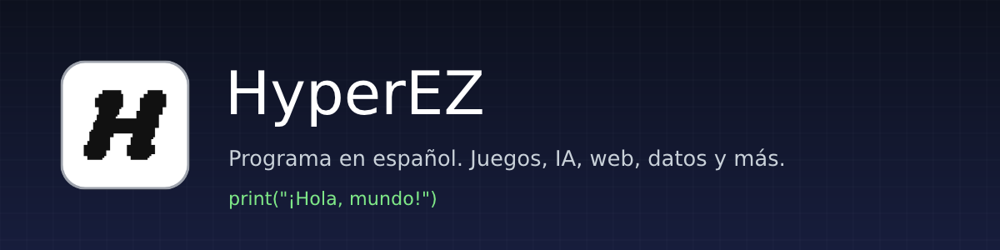

<p align="center">
  
</p>

<p align="center">
  <a href="https://github.com/cuevacaravacaadrian/HyperEZ/actions/workflows/ci.yml"></a>
  <a href="https://github.com/cuevacaravacaadrian/HyperEZ/releases/latest"></a>
  
  <a href="LICENSE"></a>
</p>

<p align="center">
  <a href="https://github.com/cuevacaravacaadrian/HyperEZ/releases/latest"></a>
</p>

<p align="center">
  <a href="docs/empezar/instalacion.md"><b>Instalar</b></a> ·
  <a href="docs/empezar/primeros-pasos.md"><b>Primeros pasos</b></a> ·
  <a href="docs/GUIA.md"><b>Guía</b></a> ·
  <a href="docs/README.md"><b>Documentación</b></a> ·
  <a href="examples"><b>Ejemplos</b></a> ·
  <a href="CHANGELOG.md"><b>Novedades</b></a>
</p>

**HyperEZ** es un lenguaje de programación con mensajes en español, pensado para aprender a programar y para hacer de todo: juegos, inteligencia artificial, webs, datos, gráficos, sonido, scripts del sistema y herramientas de bajo nivel. Trae su propio editor, su biblioteca completa y sus herramientas en una sola instalación.

## 🚀 Empieza en un minuto

1. Descarga **[HyperEZ-Setup-0.8.1.exe](https://github.com/cuevacaravacaadrian/HyperEZ/releases/latest)** y pulsa **Instalar** (no necesita administrador).
2. Al terminar se abre **HyperEZ Editor** con tu primer programa.
3. Pulsa **F5**. Ya está.

<p align="center">
  
</p>

El editor es clásico y sencillo: barra de herramientas, **pestañas**, colores, errores mientras escribes (con la línea y cómo arreglarlo), **panel de salida** (Mayús+F5) para ver el resultado sin salir, autocompletado con **Ctrl+Espacio**, formato con **Ctrl+Mayús+F**, imprimir, plantillas y todos los ejemplos. Los programas se guardan como **`.hez`**, y cualquier `.hez` o `.hz` se ejecuta con doble clic. Todo en [HyperEZ Editor](docs/herramientas/editor.md).

> El lenguaje se instala integrado en Windows (archivos, `PATH`, menú Inicio, *Win+R → hyper*); HyperEZ Editor y la extensión de VS Code son complementos que puedes desmarcar.

```hz
class Jugador {
    var nombre: text
    var vida = 3
    constructor(nombre: text) { this.nombre = nombre }
    get vivo(): bool { return vida > 0 }
}

var ana = Jugador("Ana")
print("¡Hola, ${ana.nombre}! Vidas: ${ana.vida}")
```

Si te equivocas, HyperEZ te lo dice en español antes de ejecutar y te propone el arreglo:

```text
error[E0205]: No existe nada llamado 'pirnt'
  --> juego.hez:3:1
 3 | pirnt("¡Hola!")
   | ^^^^^
   = ayuda: ¿quisiste decir 'print'?
```

## 📥 Instalar

| Sistema | Cómo |
|---|---|
| **Windows** | **`HyperEZ-Setup-0.8.1.exe`** de la [última versión](https://github.com/cuevacaravacaadrian/HyperEZ/releases/latest): HyperEZ, HyperEZ Editor, ejemplos, documentación y la extensión de VS Code. |
| **Linux / macOS** | `HyperEZ-0.8.1-linux-x64.tar.gz` (o `macos-arm64`): descomprímelo y ejecuta `sh install.sh`. |
| **VS Code** | Lo instala el instalador de Windows; también `code --install-extension hyperez-0.8.1.vsix`. |

En Windows, los `.hez` y `.hz` se abren **siempre** con HyperEZ (doble clic = ejecutar) y el clic derecho ofrece *Editar con HyperEZ Editor*, *Editar con VS Code*, *Comprobar errores* y *Ejecutar y repetir al guardar*; en cualquier carpeta, *Nuevo → Programa HyperEZ* y *Abrir HyperEZ aquí*. Detalles en la [guía de instalación](docs/empezar/instalacion.md).

## ⚡ Tres formas de programar

| | Para quién | Cómo |
|---|---|---|
| **HyperEZ Editor** | para empezar: sencillo y clásico | menú Inicio o escritorio → escribe → **F5** |
| **Visual Studio Code** | para proyectos grandes | errores, autocompletado, F12, F2, botones **▶ Ejecutar · ⟳ Repetir · ✓ Comprobar** encima del código |
| **Consola interactiva** | para probar ideas | escribe `hyper`: cada línea se ejecuta al pulsar Intro |

```text
hz> var precios = [3.5, 12, 7.25]
hz> precios.sum()
22.75
hz> precios.map(p => round(p * 1.21, 2))
[4.24, 14.52, 8.77]
```

Y además `hyper watch juego.hez` (vuelve a ejecutar cada vez que guardas) y `hyper new mi-juego --tipo juego|app|ia|script` (un proyecto ordenado que funciona desde el primer momento).

## 🌐 Hacer webs

```text
hyper new mi-web --tipo web       una aplicación: plantillas HTML, formulario, API JSON y CSS
hyper new mi-blog --tipo sitio    un sitio escrito en Markdown (blog, documentación, portfolio)
hyper serve web --abrir           sirve una carpeta y recarga el navegador cada vez que guardas
```

```hz
import web
var app = web.App()
app.get("/", req => web.html("<h1>¡Hola desde HyperEZ!</h1>"))
app.get("/api/saludo/:nombre", req => ({ saludo: "Hola, " + req.params.nombre }))
app.post("/contacto", req => web.html("Gracias, " + web.form(req).get("nombre", "anónimo")))
print(app.handle(web.request("GET", "/api/saludo/Ana")))
// app.listen(8080, { open: true }) la sirve de verdad y abre el navegador
```

Rutas con parámetros, archivos estáticos, plantillas con `{{variables}}`, formularios, cookies, JSON y sitios enteros desde Markdown con menú y estilo. Todo en [hacer webs](docs/biblioteca/web.md).

## 🧰 Qué se puede hacer

<table>
<tr><td width="50%" valign="top">

**🎮 Juegos de consola**
```hz
var pos = Vec2(0, 0)
foreach tecla in ["right", "right", "down"] {
    pos = pos + match tecla {
        "right" => Vec2(1, 0)
        "down" => Vec2(0, 1)
        else => Vec2(0, 0)
    }
}
print("El héroe está en", pos)
```

</td><td width="50%" valign="top">

**🧠 Inteligencia artificial**
```hz
import ai
randomSeed(1)
var red = ai.NeuralNetwork([2, 8, 1], "tanh")
var X = [[0, 0], [0, 1], [1, 0], [1, 1]]
red.train(X, [[0], [1], [1], [0]], 2000, 0.5)
print("XOR aprendido:", red.classify(X))
```

</td></tr>
<tr><td valign="top">

**🌐 Webs y APIs**
```hz
import web
var app = web.App()
app.get("/hola/:nombre", req => "Hola, " + req.params.nombre)
print(app.handle(web.request("GET", "/hola/Ana")))
// app.listen(8080) para servirla de verdad
```

</td><td valign="top">

**📊 Datos y estadística**
```hz
import csv
import stats
var filas = csv.parse("mes,ventas\nene,120\nfeb,95\nmar,160")
var ventas = filas.map(f => f.ventas)
print(stats.mean(ventas), ventas.median(), ventas.sum().format())
```

</td></tr>
<tr><td valign="top">

**🧩 Algoritmos y estructuras de datos**
```hz
import algo
import collections
var mapa = ["S..#", ".#..", "...G"]
print(algo.gridPath(mapa, [0, 0], [3, 2]).length, "casillas")
var rutas = collections.Graph()
rutas.addEdge("Madrid", "Toledo", 72)
rutas.addEdge("Toledo", "Ciudad Real", 117)
print(rutas.shortestPath("Madrid", "Ciudad Real"))
```

</td><td valign="top">

**📄 Documentos y archivos**
```hz
import template
import markdown
import zip
var md = template.render("# {{t}}\n\n**{{n}}** puntos", { t: "Hola", n: 42 })
print(markdown.toHtml(md))
var z = Path.join(Path.temp, "copia.zip")
zip.create(z, { "notas.txt": "¡hola!" })
print(zip.list(z))
```

</td></tr>
<tr><td valign="top">

**🖼️ Gráficos y 🔊 sonido**
```hz
import audio
import svg
var im = Image(200, 100, "#0f1424")
im.ellipse(100, 50, 60, 30, "#2f81f7")
im.save(Path.join(Path.temp, "logo.png"))
svg.barChart({ ene: 3, feb: 5 }).save(Path.join(Path.temp, "barras.svg"))
audio.Sound().melody("C4 E4 G4", 0.2).save(Path.join(Path.temp, "do-mi-sol.wav"))
print("imagen, gráfica y sonido creados")
```

</td><td valign="top">

**⚙️ Sistema y bajo nivel**
```hz
var r = Process.run(System.exe, ["version"])
print(r.output.lines()[0])
var b = Bytes("HZS1").pushU16(2).pushU32(15)
print(b.toHex(" "), Hash.crc32(b), Hash.sha1("abc").substring(0, 8))
print((255).toHex(), (2026).toRoman(), Regex(r"\d+").findAll("1 22 333").length)
```

</td></tr>
</table>

Y también: archivos y rutas, fechas en español, JSON, base de datos de documentos, expresiones regulares, peticiones HTTPS, servidor web, matrices en C++ (con inversa, determinante y sistemas de ecuaciones), configuración INI, registro de mensajes, ensamblador x86 para sectores de arranque, pruebas integradas, eventos y tareas `async`/`await`. Mira el [mapa de la biblioteca](docs/biblioteca/README.md) y los [ejemplos por áreas](examples).

## ✨ El lenguaje

- **Tipos opcionales** (tipado gradual): escríbelos cuando ayuden; si no, HyperEZ deduce muchos solo.
- **Clases, structs, interfaces y enums**, herencia, propiedades `get`/`set`, sobrecarga de operadores.
- **`match`** con valores, rangos, guardas y bloques.
- **Funciones** con valores por defecto, argumentos con nombre, `...resto`, lambdas y clausuras.
- **Desestructuración**: `var [a, b] = lista`, `var {nombre, vida} = jugador`; **propagación**: `[...a, ...b]`, `{...base, color: "rojo"}`.
- **Comprensiones**: `[x * x for x in 1..=10 if x % 2 == 0]`, `{n: n * n for n in 1..=3}`; **tubería**: `datos |> limpiar |> ordenar`; **trozos**: `lista[2..]`, `texto[..3]`.
- **Textos con formato**: `"${precio:.2f} €"`, `"${nombre:<10}"`, `"${0.25:%}"`; y **bucles** `while`, `do { } while`, `for`, `foreach` y `repeat`.
- **Errores** con `try`/`catch`/`finally` y tipos de error propios.
- **Eventos** (`event`, `on`, `emit`) y **tareas asíncronas** (`async`, `await`, `spawn`).
- **Módulos** con `import` y 19 bibliotecas incluidas (la última, `validate`: correos, DNI, IBAN y formularios).

Toda la sintaxis está en la [referencia del lenguaje](docs/lenguaje/README.md), con su [gramática](docs/lenguaje/gramatica.md).

## 🛠️ Herramientas

| Orden | Qué hace |
|---|---|
| `hyper` | consola interactiva |
| `hyper archivo.hez` | ejecuta un programa |
| `hyper watch [archivo]` | ejecuta y repite al guardar |
| `hyper serve [carpeta]` | sirve una web y recarga el navegador al guardar |
| `hyper check` | busca errores sin ejecutar |
| `hyper test` | ejecuta las pruebas (`test(...)` y salidas esperadas `.out`) |
| `hyper fmt` | ordena la sangría y los espacios sin cambiar lo que hace el código |
| `hyper new <nombre> --tipo T` | crea un proyecto: juego, app, ia, script, web o sitio |
| `hyper bytecode archivo` | enseña las instrucciones que genera el compilador |
| `hyper docs` | genera la referencia de la API |
| `hyper lsp` | servidor de lenguaje para cualquier editor |

La **extensión de VS Code** trae errores en vivo, autocompletado según el tipo, documentación al pasar el ratón, ir a la definición, renombrar, arreglos rápidos, formato, botones de ejecutar encima del código, 54 fragmentos, el tema *HyperEZ Noche* y un tutorial de bienvenida. Ver [VS Code](docs/herramientas/vscode.md).

También hay colores para **Notepad++, Sublime Text, Vim y highlight.js**, y cualquier editor con LSP (Neovim, Helix, Zed...) puede usar `hyper lsp`: [otros editores](editors/README.md). La documentación completa se instala también **en HTML**, para leerla sin conexión.

## 🏎️ Rendimiento

Bytecode en una máquina virtual optimizada: cachés en línea, instrucciones fusionadas (comparar y saltar, guardar y descartar, bucles `for` con una instrucción por vuelta), llamadas directas, asignador de objetos propio y compilación con LTO y PGO. Lo pesado (matrices, imágenes, expresiones regulares, compresión, HTTP) va en C++. Los números de cada versión están en [rendimiento](docs/interno/rendimiento.md).

## 🧑‍💻 Compilar desde el código

```powershell
./build.ps1              # Windows: compila (con PGO), pasa las pruebas, empaqueta la extensión y crea el instalador
```

```text
cmake -S . -B build -G Ninja -DCMAKE_BUILD_TYPE=Release     # Linux y macOS
cmake --build build && ctest --test-dir build
```

Requisitos y detalles en [CONTRIBUTING.md](CONTRIBUTING.md). Cómo está hecho por dentro: [arquitectura](docs/interno/arquitectura.md).

## 📁 Estructura del repositorio

| Carpeta | Contenido |
|---|---|
| [`src/core`](src/core) | utilidades comunes: texto, UTF-8, archivos, consola, procesos |
| [`src/lang`](src/lang) | el lenguaje: `syntax` (lexer, parser, formateador), `sema` (analizador), `compiler` (bytecode y desensamblador), `vm` (máquina virtual), `stdlib` (biblioteca nativa), `prelude` |
| [`src/lib`](src/lib) | bibliotecas escritas en HyperEZ: `ai`, `stats`, `csv`, `cli`, `web`, `html`, `db`, `audio`, `x86`, `collections`, `algo`, `template`, `markdown`, `ini`, `log`, `svg`, `zip`, `site` |
| [`src/tools`](src/tools) | la orden `hyper`: CLI, consola interactiva, watch, servidor de lenguaje, integración con el sistema |
| [`src/editor`](src/editor) | HyperEZ Editor (Windows) |
| [`editors`](editors) | extensión de VS Code, colores para Notepad++, Sublime y Vim, highlight.js y el kit para GitHub Linguist |
| [`actions`](actions/setup-hyperez) | la acción `setup-hyperez` para usar HyperEZ en GitHub Actions |
| [`packaging`](packaging) | instalador de Windows, paquetes de Linux y macOS, iconos |
| [`examples`](examples) | ejemplos por áreas: juegos, algoritmos, IA, datos, web, gráficos, audio, sistema... |
| [`tests`](tests) | pruebas del lenguaje, las bibliotecas, la consola, el formato y los errores |
| [`docs`](docs) | documentación completa |
| [`tools`](tools) | scripts de mantenimiento |

## 🤝 Contribuir

Las ideas, los avisos de errores y los cambios son bienvenidos: lee [CONTRIBUTING.md](CONTRIBUTING.md) y el [código de conducta](CODE_OF_CONDUCT.md). Para dudas, [SUPPORT.md](SUPPORT.md).

## 📄 Licencia

[MIT](LICENSE) © 2026 Adrián Cueva Caravaca. Las bibliotecas de `third_party/` y la fuente DejaVu mantienen sus propias licencias.
