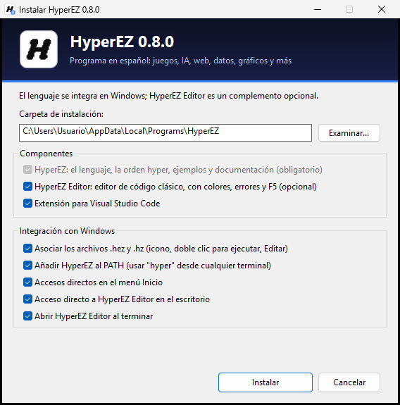

# Instalación

## Windows

1. Descarga `HyperEZ-Setup-<versión>.exe` de la [página de versiones](https://github.com/cuevacaravacaadrian-ux/HyperEZ/releases/latest).
2. Ejecútalo y pulsa **Instalar**. No necesita permisos de administrador. Si aparece "Windows protegió su PC" (el instalador no está firmado), pulsa *Más información → Ejecutar de todas formas*.
3. Al terminar se abre **HyperEZ Editor** con un programa de ejemplo: pulsa **F5** y ya estás programando.



El instalador tiene dos apartados: **Componentes** (el lenguaje, obligatorio; HyperEZ Editor y la extensión de VS Code, opcionales) e **Integración con Windows**. Por defecto:

- copia HyperEZ y **HyperEZ Editor** en `%LOCALAPPDATA%\Programs\HyperEZ`, con la documentación también en HTML;
- hace que **todos los archivos `.hez` y `.hz`** se abran siempre con HyperEZ (con su icono): doble clic para ejecutar. Si antes habías elegido otro programa para ellos, deja de tener prioridad;
- añade al menú contextual de los archivos: *Editar con HyperEZ Editor*, *Editar con Visual Studio Code* (si lo tienes), *Comprobar errores* y *Ejecutar y repetir al guardar*; en cualquier carpeta, *Nuevo → Programa HyperEZ* y *Abrir HyperEZ aquí* (consola interactiva);
- crea la carpeta `Documentos\HyperEZ` para tus programas;
- añade `hyper` al `PATH` (para usarlo en una terminal **nueva**: `hyper version`);
- crea accesos en el menú Inicio (HyperEZ Editor, consola interactiva, terminal, ejemplos, guía, referencia de la API y desinstalar) y, si quieres, en el escritorio;
- instala la extensión de VS Code si tienes VS Code.

Se desinstala desde *Configuración → Aplicaciones → HyperEZ* (o con el acceso del menú Inicio).

### Instalación silenciosa

```text
HyperEZ-Setup-0.8.0.exe /S                  sin preguntas
HyperEZ-Setup-0.8.0.exe /S /D=C:\HyperEZ    en otra carpeta
HyperEZ-Setup-0.8.0.exe /S /OPENEDITOR      y abre el editor al terminar
```

Opciones: `/NOASSOC` (no asociar archivos), `/NOPATH`, `/NOSHORTCUTS`, `/NODESKTOP`, `/NOVSCODE`, `/NOEDITOR` (solo el lenguaje), `/OPENEDITOR`.

## Linux y macOS

1. Descarga `HyperEZ-<versión>-linux-x64.tar.gz` (o `-macos-arm64`) de la página de versiones.
2. Descomprímelo e instala para tu usuario (sin `sudo`):

```text
tar xzf HyperEZ-0.8.0-linux-x64.tar.gz
cd HyperEZ-0.8.0-linux-x64
sh install.sh
```

Queda en `~/.local/bin/hyper`. En Linux, `install.sh` además asocia los `.hz` y `.hez` en el escritorio (tipo MIME `text/x-hyperez`) para abrirlos con doble clic. Para desinstalar: `sh install.sh --uninstall`.

En cualquier sistema, `hyper register` asocia los archivos con el `hyper` que lo ejecuta y `hyper unregister` lo deshace.

## La extensión de Visual Studio Code

La instala el instalador de Windows. También se puede instalar a mano: en VS Code, *Extensiones → ⋯ → Instalar desde VSIX…* y elige `hyperez-<versión>.vsix`, o desde la terminal:

```text
code --install-extension hyperez-0.8.0.vsix
```

## Desde el código fuente

Mira [CONTRIBUTING.md](../../CONTRIBUTING.md): en Windows basta con `./build.ps1`; en Linux y macOS, CMake y un compilador de C++20:

```text
cmake -S . -B build -G Ninja -DCMAKE_BUILD_TYPE=Release
cmake --build build
ctest --test-dir build
```
