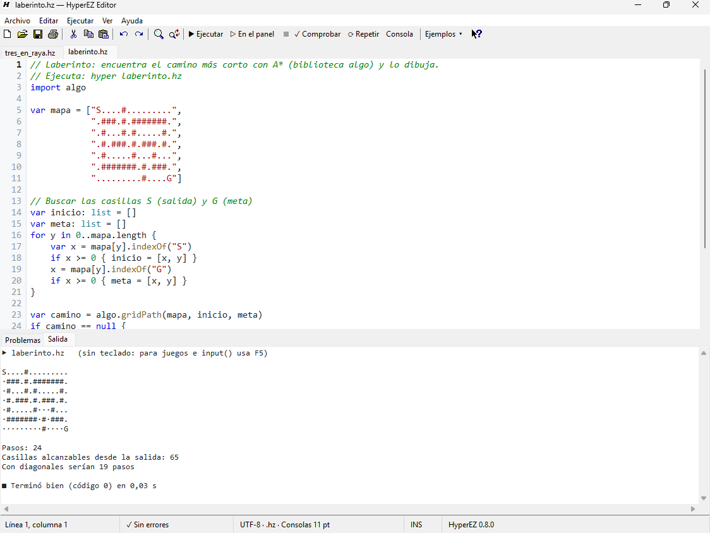

# HyperEZ Editor

Un editor de código sencillo y clásico, con fondo blanco, que se instala con HyperEZ en Windows como complemento del lenguaje. Es la forma más rápida de empezar: lo abres, escribes y pulsas **F5**.

Tiene lo que se espera de un editor de los de siempre: **barra de herramientas** con los iconos de Windows, un **Explorador** con las carpetas del proyecto, **pestañas** para tener varios programas abiertos, **panel de salida** para ver el resultado sin salir del editor, **imprimir**, elegir la **fuente** y el indicador **INS/SOB** (insertar o sobrescribir). También está en el navegador, sin instalar nada: el [editor web](editor-web.md).

## Abrirlo

- Al terminar la instalación se abre solo (casilla *Abrir HyperEZ Editor al terminar*).
- Menú Inicio → **HyperEZ Editor**, o el acceso directo del escritorio.
- Clic derecho en un archivo `.hez` o `.hz` → **Editar con HyperEZ Editor** (o *Abrir con → HyperEZ Editor*).
- Clic derecho en una carpeta → *Nuevo → Programa HyperEZ* crea un `.hez` vacío.
- Desde VS Code: *HyperEZ: Abrir en HyperEZ Editor*.

Los programas nuevos se guardan como **`.hez`** en `Documentos\HyperEZ` (puedes elegir otra carpeta).

## Lo que hace

| | |
|---|---|
| **Colores** | palabras clave, textos (y lo que va dentro de `${...}`), números, comentarios, tipos y llamadas. Usa el analizador del propio lenguaje, así que colorea igual que el compilador entiende el código. |
| **Errores mientras escribes** | el panel de abajo lista los errores y avisos con su línea; doble clic lleva a cada uno. La parte del código con el error se marca en rojo claro y su número de línea también. |
| **Ejecutar sin guardar (F5)** | ejecuta lo que ves en el editor en una consola nueva, que espera una tecla al terminar, **aunque no lo hayas guardado** (ni le hayas puesto nombre). Las importaciones funcionan igual que con el archivo guardado. Los juegos de consola funcionan con el teclado. |
| **Explorador (Ctrl+Mayús+E)** | a la izquierda, las carpetas y archivos del proyecto, con el icono de HyperEZ en los `.hez`. Un clic abre un archivo o una carpeta; clic derecho para **nuevo archivo, nueva carpeta, renombrar (F2), eliminar (Supr, a la papelera)**, mostrarlo en el Explorador de Windows o copiar su ruta. *Archivo → Abrir carpeta en el Explorador* elige otra carpeta; la franja de su derecha se arrastra para cambiar el ancho. |
| **Cerrar parejas** | al escribir `(`, `[`, `{`, `"` o `'` aparece también el cierre, con el cursor en medio; si escribes el cierre, se salta el que ya estaba. Con texto seleccionado, lo rodea. Retroceso entre una pareja vacía borra las dos, e Intro entre `{}` deja el cierre en su línea. |
| **Ejecutar en el panel (Mayús+F5)** | también sin guardar; el resultado sale abajo, en la pestaña *Salida*, con el tiempo que tardó y si terminó bien. Doble clic en una línea con `archivo.hez:12` lleva a esa línea. **■** (o Ctrl+Pausa) detiene el programa. Sin teclado: para juegos e `input()` usa F5. |
| **Pestañas** | cada archivo en su pestaña (Ctrl+N nueva, Ctrl+W cerrar, Ctrl+Tab cambiar; el botón central del ratón cierra). Abrir un archivo que ya está abierto va a su pestaña. Al salir pregunta por cada una con cambios. |
| **Repetir al guardar (Ctrl+F5)** | ejecuta en modo *watch*: cada vez que guardas, vuelve a ejecutarse. |
| **Consola interactiva (F6)** | abre `hyper repl` en la carpeta del archivo. |
| **Comprobar (F7)** | busca errores sin ejecutar. |
| **Autocompletado (Ctrl+Espacio)** | palabras clave, todas las funciones, módulos y clases, y los nombres de tu archivo. Tras `Console.` o `Time.` muestra sus funciones; la firma aparece en la barra de estado. |
| **Firmas** | al escribir `(` tras una función, la barra de estado enseña sus parámetros. |
| **Sangría automática** | Intro mantiene la sangría y añade un nivel tras `{`, `[` o `(`; al escribir `}` se quita un nivel. Tab y Mayús+Tab sangran varias líneas. |
| **Formatear (Ctrl+Mayús+F)** | ordena la sangría y los espacios como `hyper fmt`. Se deshace con Ctrl+Z. |
| **Buscar y reemplazar** | Ctrl+F, F3 (siguiente), Ctrl+H; Ctrl+G va a una línea. |
| **Imprimir (Ctrl+P)** | con los colores del código, el nombre del archivo y el número de página. |
| **Fuente** | *Ver → Fuente…* elige cualquier fuente de ancho fijo (Consolas, Cascadia Mono, Courier New...). |
| **INS / SOB** | la tecla Insert cambia entre insertar y sobrescribir; la barra de estado lo indica. |
| **Barras** | *Ver* muestra u oculta la barra de herramientas, la de estado y el panel de problemas y salida. |
| **Separador** | la franja entre el código y el panel de abajo se arrastra con el ratón para hacer el panel más alto o más bajo; el editor recuerda el alto. |
| **Comentar (Ctrl+/)** y **duplicar línea (Ctrl+D)** | |
| **Zoom** | Ctrl+rueda, Ctrl++ y Ctrl+-; Ctrl+0 vuelve al tamaño normal. Se recuerda para la próxima vez. |
| **Plantillas** | *Archivo → Nuevo desde plantilla*: juego de consola, clase con pruebas, inteligencia artificial, servidor web, dibujar una imagen, leer un CSV. |
| **Ejemplos** | *Archivo → Abrir ejemplo* (o el botón *Ejemplos*) con todos los ejemplos instalados, por áreas. |
| **Recientes, arrastrar y soltar** | los últimos 10 archivos; también puedes soltar un archivo en la ventana. |
| **Ayuda (F1)** | la guía del lenguaje, la documentación completa y la referencia de todas las funciones. |

Si cierras con cambios sin guardar, pregunta antes. El título muestra `•` mientras hay cambios (si deshaces hasta lo guardado, desaparece).

## Atajos

| Tecla | Acción |
|---|---|
| F5 | Ejecutar en una consola (sin guardar) |
| Mayús+F5 | Ejecutar en el panel de salida (sin guardar) |
| Ctrl+Mayús+E | Mostrar u ocultar el Explorador |
| F2 / Supr (en el Explorador) | Renombrar / eliminar |
| Ctrl+Pausa | Detener el programa del panel |
| Ctrl+F5 | Ejecutar y repetir al guardar |
| F6 | Consola interactiva |
| F7 | Comprobar errores |
| Ctrl+N / Ctrl+O / Ctrl+S / Ctrl+Mayús+S | Pestaña nueva / Abrir / Guardar / Guardar como |
| Ctrl+W / Ctrl+Tab / Ctrl+Mayús+Tab | Cerrar la pestaña / siguiente / anterior |
| Ctrl+P | Imprimir |
| Ctrl+F / F3 / Ctrl+H | Buscar / siguiente / reemplazar |
| Ctrl+G | Ir a la línea |
| Ctrl+Espacio | Completar nombre |
| Ctrl+/ | Comentar o descomentar |
| Ctrl+D | Duplicar la línea |
| Ctrl+Mayús+F | Formatear documento |
| Tab / Mayús+Tab | Sangrar / quitar sangría |
| Ctrl++ / Ctrl+- / Ctrl+0 | Tamaño del texto |
| F1 | Guía del lenguaje |
| Insert | Insertar o sobrescribir |

## Cómo está hecho

Es un programa de Windows nativo (`bin\hyperez-editor.exe`, en `src/editor/editor.cpp`) escrito en C++ con la API de Win32 y el control RichEdit. Enlaza la misma biblioteca `hzlang` que `hyper.exe`:

- los colores salen del **lexer** de HyperEZ (también dentro de las interpolaciones `${...}`);
- los errores salen del **analizador** (`compileSource` sin generar código), en una máquina virtual nueva cada vez que dejas de escribir 0,7 segundos;
- el autocompletado usa el **catálogo de la API** que registran las funciones nativas y las bibliotecas incluidas;
- *Formatear* llama al mismo **formateador** que `hyper fmt`;
- *Ejecutar* lanza el `hyper.exe` que está junto al editor.

- *Ejecutar en el panel* lanza `hyper run` con la salida redirigida (sin colores, con `NO_COLOR=1`) y la va mostrando mientras llega.
- La Ayuda abre la documentación en HTML que instala el instalador (`docs-html/`), en el navegador.

Los ajustes (fuente, tamaño de letra, ajuste de línea, barras, paneles y su alto, archivos recientes y posición de la ventana) se guardan en `HKEY_CURRENT_USER\Software\HyperEZ\Editor`; el desinstalador los borra.
