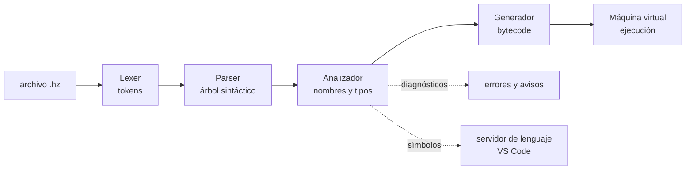

# Arquitectura

HyperEZ es un lenguaje **compilado a bytecode** que se ejecuta en una **máquina virtual de pila**, todo dentro de un único ejecutable escrito en C++20 (`hyper`). Este documento es el mapa; los detalles están en [el compilador](compilador.md), [la máquina virtual](maquina-virtual.md) y [el rendimiento](rendimiento.md).

## Del texto a la ejecución



1. **Lexer** (`src/lang/syntax/lexer.cpp`): convierte el texto en *tokens* (números, textos con sus partes `${}`, palabras clave, operadores) y guarda los comentarios (los `///` son documentación).
2. **Parser** (`src/lang/syntax/parser.cpp`): descenso recursivo que construye el árbol sintáctico (`ast.h`). Se recupera de los errores para seguir analizando el resto del archivo, y traduce el azúcar sintáctico (por ejemplo, la desestructuración) a construcciones básicas.
3. **Analizador** (`src/lang/sema/analyzer.cpp`): resuelve cada nombre (local, global, de otro módulo, integrado), deduce y comprueba los tipos (tipado gradual), y registra símbolos, ámbitos y referencias para el editor. Aquí nacen casi todos los mensajes de error en español.
4. **Generador de código** (`src/lang/compiler/codegen.cpp`): recorre el árbol ya analizado y emite el bytecode de cada función (`bytecode.h`), con optimizaciones de mirilla (*peephole*).
5. **Máquina virtual** (`src/lang/vm/`): ejecuta el bytecode con una pila de valores, un recolector de basura, fibras para `async`/`await` y eventos.

Todo el proceso tarda unos milisegundos: `hyper programa.hz` arranca, compila y ejecuta un programa pequeño en menos de 20 ms.

## Carpetas del código

```text
src/
  core/               utilidades comunes: texto, UTF-8, archivos, consola, procesos
  lang/
    syntax/           lexer, parser y árbol sintáctico
    sema/             analizador (tipos, nombres) y diagnósticos
    compiler/         generador de bytecode y lista de instrucciones
    vm/               máquina virtual: valores, objetos, GC, intérprete, fibras, eventos
    stdlib/           biblioteca nativa, un archivo por área
      builtins.cpp      funciones globales, texto, listas, mapas, JSON, tareas, eventos
      extra.cpp         pruebas, consola, File y System básicos, métodos extra
      system.cpp        Process, Path, Time, más File y System
      binary.cpp        Bytes, Hash, Base64, bases numéricas
      regex.cpp         Regex
      net.cpp           Http
      matrix.cpp        Matrix
      mathtypes.cpp     Vec2, Vec3, Color
    prelude/          preludio escrito en HyperEZ (awaitAll, awaitAny...)
  lib/                bibliotecas escritas en HyperEZ: ai, stats, csv, cli, x86
  tools/
    cli/              la orden hyper y sus plantillas de proyecto
    repl/             consola interactiva
    watch/            modo watch
    lsp/              servidor de lenguaje (Language Server Protocol)
    platform/         integración con Windows (registro, accesos) y Linux (xdg)
packaging/            instalador de Windows, paquetes de Linux y macOS, iconos
editors/vscode/       extensión de VS Code
tests/                pruebas (lenguaje, bibliotecas, juegos, errores, consola)
examples/             ejemplos por áreas
docs/                 esta documentación
tools/                scripts de mantenimiento (versión, documentación generada)
```

## Un solo ejecutable

`hyper` contiene el compilador, la máquina virtual, la biblioteca estándar, las bibliotecas `.hz` (incrustadas al compilar con `cmake/embed_hz.cmake`), la consola interactiva, el modo watch y el servidor de lenguaje. En Windows se enlaza de forma estática: no depende de ninguna DLL.

## El servidor de lenguaje

`hyper lsp` habla el protocolo LSP por la entrada y salida estándar. Por cada documento abierto ejecuta lexer, parser y analizador (sin generar código) y responde con los diagnósticos, autocompletado, hover, definición, referencias, renombrado y esquema a partir de los símbolos y referencias que guarda el analizador. La extensión de VS Code es un cliente fino sobre él, así que cualquier editor con soporte LSP puede usarlo.
